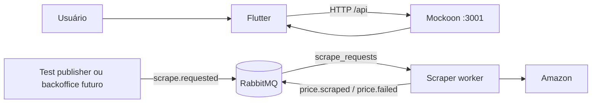
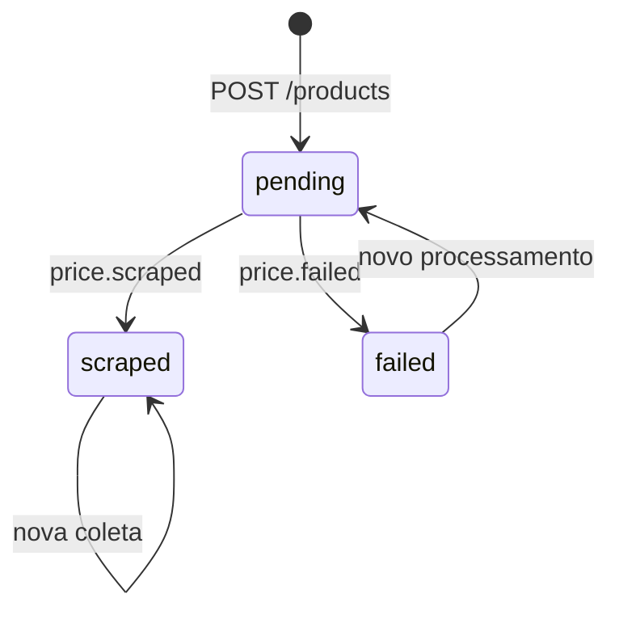
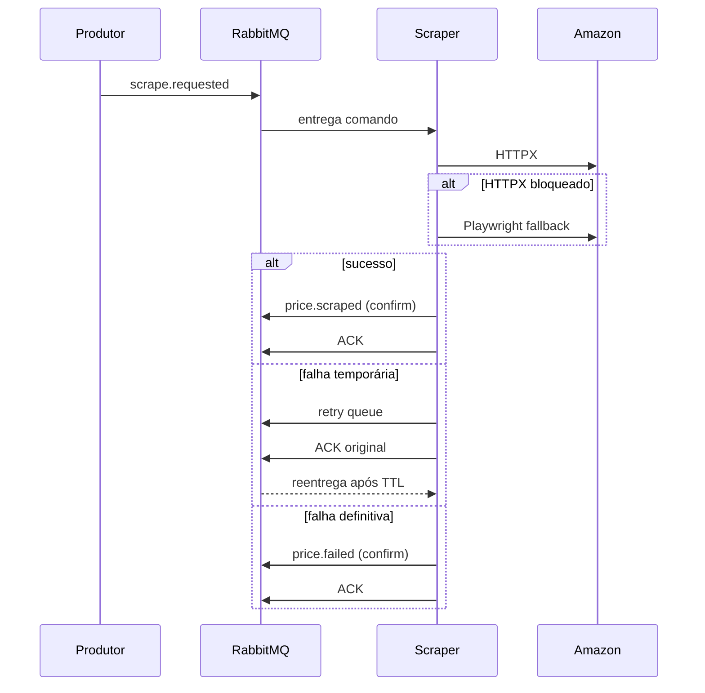

# BAIXOU — documentação técnica do app e do scraper

## 1. Escopo

Esta documentação cobre o cliente Flutter, a API Mockoon, o scraper Python e o contrato RabbitMQ. O backoffice real não faz parte desta implementação; o contrato abaixo é o ponto de integração que ele deverá respeitar.

## 2. Arquitetura de desenvolvimento



O Mockoon substitui somente o backoffice HTTP. O RabbitMQ testa o scraper de forma independente.

## 3. Camadas do Flutter

```text
Presentation (Screens + ChangeNotifier)
        ↓
Domain (Entities + Repository contracts)
        ↓
Data (Repository implementations)
        ↓
ApiClient
        ↓
Mockoon ou backoffice real
```

Conceitos aplicados:

- **Repository Pattern:** separa o domínio do transporte HTTP.
- **Dependency Injection:** notifiers aceitam repositórios alternativos.
- **Single source of truth:** notifiers mantêm o estado apresentado pelas telas.
- **DTO mapping:** `fromJson` converte o contrato HTTP em entidades tipadas.
- **Environment-based configuration:** mock/real é escolhido por `API_BASE_URL`.

O `ApiClient` centraliza headers, bearer token, timeout, respostas `401`, validações `422` e GET/POST/PATCH/DELETE.

## 4. Estados de produto



- `pending`: aguardando o worker.
- `scraped`: possui preço válido e horário da última raspagem.
- `failed`: terminou sem preço; `last_error_reason` explica a causa.

## 5. Contrato HTTP mockado

Base local: `http://localhost:3001/api`.

| Grupo | Métodos e caminhos |
|---|---|
| Autenticação | `POST /auth/register`, `/activate`, `/login`, `/logout`, `/forgot-password`, `/verify-reset-code`, `/reset-password`; `GET /auth/me` |
| Produtos | `GET /products`, `GET /products/catalog`, `POST /products`, `GET/DELETE /products/:id`, `GET /products/:id/price-history` |
| Demonstração | `POST /products/:id/simulate-price-drop` |
| Alertas | `GET/POST /alerts`, `DELETE /alerts/:id` |
| Notificações | `GET /notifications`, `PATCH /notifications/:id/read`, `PATCH /notifications/read-all` |

As respostas usam o envelope `{ "data": ... }`, compatível com Laravel Resources.

## 6. Fluxo assíncrono do scraper



### Topologia

| Tipo | Nome | Routing key/comportamento |
|---|---|---|
| Exchange | `scrape_commands` | `scrape.requested` |
| Queue | `scrape_requests` | comandos principais |
| Exchange/queue | `scrape_commands.retry` / `scrape_requests.retry` | TTL padrão 30 s |
| Exchange/queue | `scrape_commands.dlx` / `scrape_requests.dlq` | `scrape.dead` |
| Exchange | `price_events` | `price.scraped`, `price.failed` |

## 7. Garantias e conceitos de mensageria

- Filas, exchanges e mensagens são duráveis/persistentes.
- `prefetch=1` limita trabalho simultâneo por worker.
- ACK manual ocorre somente depois da publicação confirmada do resultado.
- Publisher confirms detectam uma publicação não confirmada pelo broker.
- `blocked` e `timeout` são retentados; comando inválido vai para DLQ.
- `request_id` correlaciona comando, logs e evento final.
- A declaração da topologia é idempotente.

RabbitMQ fornece naturalmente **at-least-once**, não exatamente-once. O backoffice deverá deduplicar eventos por `request_id`.

## 8. Contrato RabbitMQ

Comando:

```json
{
  "request_id": "01JAP8Z9N7H5AG2M1VZXJ8Q2KD",
  "product_id": 123,
  "listing_id": 456,
  "store": "amazon",
  "url": "https://www.amazon.com.br/dp/B09B8VGCR8"
}
```

Evento de sucesso:

```json
{
  "event": "price.scraped",
  "request_id": "01JAP8Z9N7H5AG2M1VZXJ8Q2KD",
  "product_id": 123,
  "listing_id": 456,
  "store": "amazon",
  "url": "https://www.amazon.com.br/dp/B09B8VGCR8",
  "title": "Echo Dot",
  "price": 329.0,
  "currency": "BRL",
  "image_url": "https://...",
  "scraped_at": "2026-10-18T20:00:00Z"
}
```

`price.failed` contém `reason`: `blocked`, `timeout`, `not_found` ou `parse_error`.

## 9. Operação local

Mockoon:

```powershell
cd C:\workspace\semestre6\app\baixou
npx @mockoon/cli start --data .\mockoon\baixou-api.json
```

Use `API_BASE_URL=http://10.0.2.2:3001/api` no Android Emulator e `http://localhost:3001/api` em Desktop/Web.

RabbitMQ e worker:

```powershell
cd C:\workspace\semestre6\scrapper\scrapping
Copy-Item .env.example .env
docker-compose up --build -d
docker-compose logs -f scraper-worker
```

Painel: `http://localhost:15672`.

Publicação manual sem backoffice:

```powershell
python publish_test_request.py "https://www.amazon.com.br/dp/B09B8VGCR8"
```

## 10. Checklist de revisão

- Importar o ambiente Mockoon e testar autenticação.
- Revisar lista normal, lista vazia, erro `422` e latência.
- Subir RabbitMQ e confirmar as filas principal, retry e DLQ.
- Publicar comando válido e observar `price.scraped`.
- Publicar JSON inválido e observar a DLQ.
- Forçar timeout/bloqueio e observar retry.
- Entregar ao responsável pelo backoffice o contrato desta documentação.
